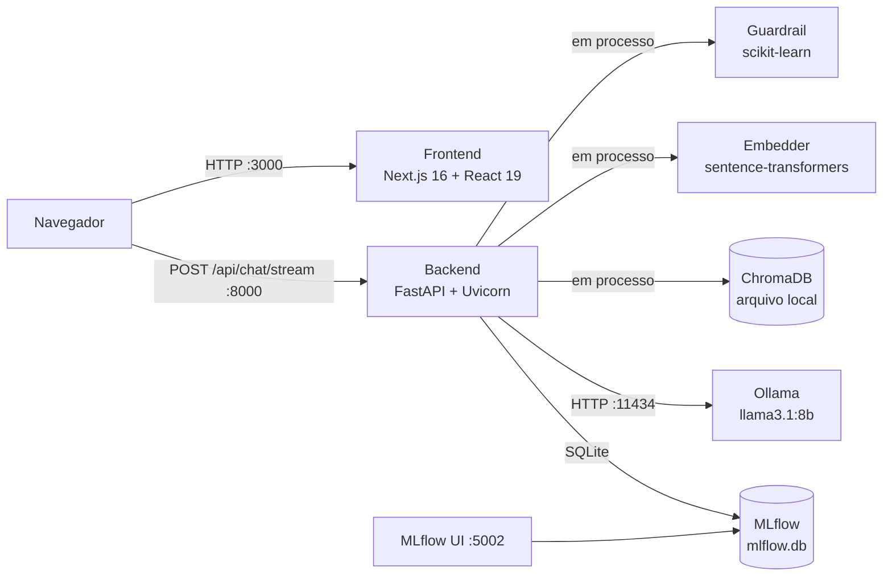
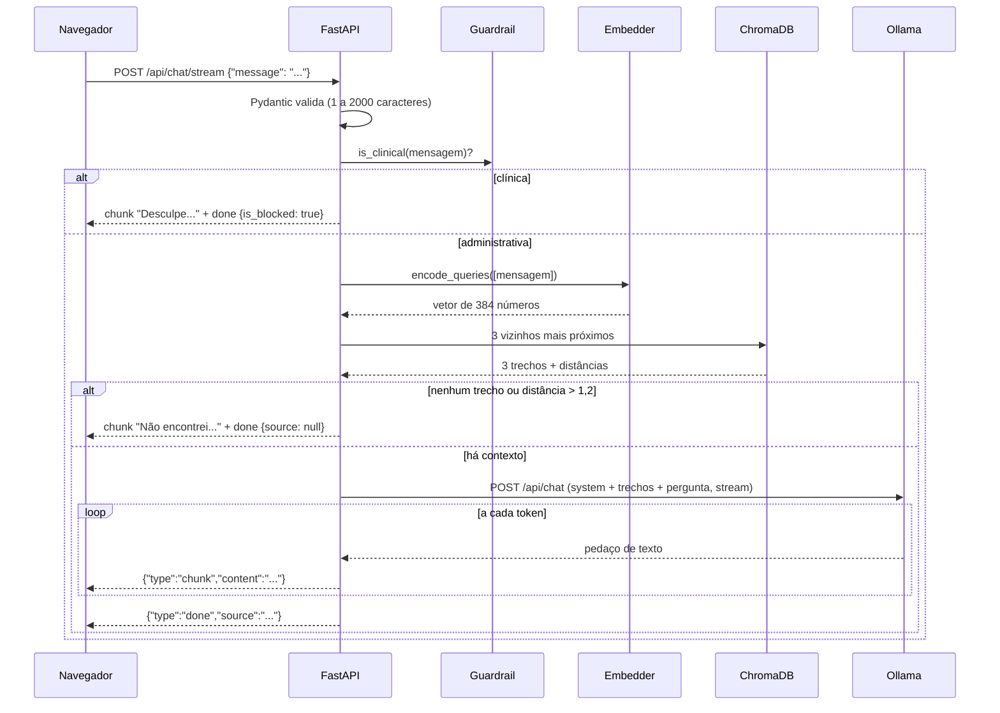

# 1. Arquitetura

## 1.1 Visão de componentes

Quatro processos rodam na mesma máquina e conversam por HTTP local.



Pontos que costumam confundir:

- O **navegador** chama o backend diretamente na porta 8000. O servidor Next.js só entrega a página; ele não faz proxy das perguntas.
- **Guardrail, embedder e ChromaDB rodam dentro do processo do backend.** Não são serviços separados. O ChromaDB é usado em modo embutido, gravando em `susana_rag_backend/data/chroma_db/`.
- **O Ollama é um processo separado.** O backend fala com ele por HTTP. É ele que carrega os 4,9 GB do modelo na memória.
- **O MLflow é um arquivo SQLite** (`mlflow.db`). A interface web do MLflow é opcional; o backend grava no arquivo sem ela.

## 1.2 Pilha de tecnologias

| Camada | Tecnologia | Versão instalada | Papel |
|---|---|---|---|
| Interface | Next.js / React / TypeScript | 16.3.8 / 19.2.8 / 5 | Tela de chat |
| Estilo | Tailwind CSS | 4 | Classes utilitárias |
| Animação e ícones | framer-motion, lucide-react | 13.5, 1.49 | Entrada dos balões, ícones |
| API | FastAPI + Uvicorn | 0.143 / 0.54 | Rotas HTTP |
| Validação | Pydantic, pydantic-settings | 2.14 / 2.15 | Contratos de entrada e configuração |
| Embeddings | sentence-transformers (PyTorch) | 6.1 (torch 2.14) | Texto → vetor |
| Banco vetorial | ChromaDB | 1.5.9 | Busca por similaridade |
| LLM | Ollama + Llama 3.1 8B | — | Geração da resposta |
| Cliente HTTP | httpx | 0.28 | Backend → Ollama |
| Classificador | scikit-learn | 1.9.1 | Guardrail |
| MLOps | MLflow | 3.17.1 | Experimentos e registro de modelos |
| Testes | pytest | — | 14 testes de integração |
| Linguagem do backend | Python | 3.14.6 | — |

## 1.3 Caminho de uma pergunta



Cada etapa em detalhe: frontend em [02](02-frontend.md), rotas em [03](03-backend-api.md), embeddings, busca e LLM em [04](04-rag.md), guardrail em [05](05-guardrails.md).

## 1.4 Organização do código

```
saude-gov-br/
├── susana-ui/                      Frontend
│   └── src/
│       ├── app/page.tsx            Tela de chat e leitura do streaming
│       ├── app/layout.tsx          Casca HTML, fonte Inter, metadados
│       ├── app/globals.css         Cores do design system
│       └── components/Chat/MessageBubble.tsx   Balão e citação de fonte
│
├── susana_rag_backend/             Backend
│   ├── app/                        Código que roda em produção
│   │   ├── main.py                 Inicialização, /health, /api/chat
│   │   ├── routers_stream.py       /api/chat/stream
│   │   ├── config.py               Configuração tipada
│   │   ├── ports.py                Interfaces e tipos de dados
│   │   ├── llm/ollama_adapter.py   Cliente do Ollama
│   │   ├── llm/prompts.py          Prompt de sistema e montagem do contexto
│   │   └── rag/
│   │       ├── corpus.py           Leitura dos .txt em blocos
│   │       ├── embeddings.py       Texto → vetor
│   │       ├── retriever.py        ChromaDB + cache semântico
│   │       ├── pipeline.py         Orquestração (rota sem streaming)
│   │       └── guardrails.py       Filtro de perguntas clínicas
│   ├── ml/                         Scripts offline (não rodam com a API)
│   │   ├── corpus/                 Coleta das páginas oficiais
│   │   ├── guardrails/train.py     Treino do classificador
│   │   ├── retrieval/              Benchmark de embeddings
│   │   └── llm/                    Benchmark de LLMs
│   ├── data/
│   │   ├── corpus/                 Textos indexados (27 blocos)
│   │   ├── chroma_db/              Banco vetorial (gerado)
│   │   └── guardrails_dataset.csv  57 frases rotuladas
│   ├── tests/test_rag.py           14 testes
│   ├── mlflow.db, mlruns/          Banco e artefatos do MLflow (gerados)
│   └── requirements.txt
│
├── notebooks/, *.py na raiz        Análise exploratória
├── <pastas de CSV>                 Bases abertas do SUS-DF
├── openspec/                       Especificações escritas antes do código
└── .agents/                        Instruções para assistentes de IA (não é código do sistema)
```

A pasta `openspec/` guarda duas propostas. A primeira (`susana-assistant-rag`) previa Gemini pela nuvem, LangChain, NeMo Guardrails e Redis. A segunda (`susana-local-llm-ml`) trocou tudo por componentes locais e é a que foi implementada. Isso explica por que `requirements.txt` ainda lista `langchain`, `langchain-google-genai` e `redis`, que o código não importa.

## 1.5 Arquitetura hexagonal: o que é e quanto dela existe aqui

A ideia do padrão *Ports & Adapters* é que o núcleo da aplicação dependa de **interfaces** (ports), e não de tecnologias. As tecnologias entram como **adaptadores** que implementam essas interfaces. O ganho é poder trocar o Ollama por outro provedor, ou por um objeto falso em um teste, sem mexer no núcleo.

O que o código implementa de fato:

| Elemento | Onde | Situação |
|---|---|---|
| `LLMPort` (interface) | [ports.py](../susana_rag_backend/app/ports.py) | Existe, como `typing.Protocol` |
| `OllamaAdapter` (adaptador) | [ollama_adapter.py](../susana_rag_backend/app/llm/ollama_adapter.py) | Implementa `LLMPort` |
| Injeção de dependência | [main.py](../susana_rag_backend/app/main.py), função `lifespan` | `RAGPipeline` recebe `llm`, `embedder`, `retriever`, `semantic_cache` pelo construtor |
| `IntentClassifierPort` | `ports.py` | Declarada, mas **ninguém a implementa**; `GuardrailsClassifier` tem outro método (`is_clinical`) |
| Port para o retriever e para o embedder | — | **Não existem**; `RAGPipeline` depende das classes concretas `ChromaRetriever` e `Embedder` |

`Protocol` em Python é **tipagem estrutural**: uma classe satisfaz a interface se tiver os mesmos métodos, sem precisar herdar dela. Por isso `OllamaAdapter` não declara `class OllamaAdapter(LLMPort)`.

Resumo honesto para uma apresentação: o projeto é **parcialmente hexagonal**. O desacoplamento está feito para o LLM; para o guardrail, o retriever e o embedder, não. Além disso, a rota de streaming acessa `pipeline.embedder`, `pipeline.retriever` e `pipeline.llm` diretamente, por fora do método `RAGPipeline.query`, o que duplica a lógica de orquestração (detalhes em [03](03-backend-api.md)).

## 1.6 Por que tudo roda localmente

A segunda proposta justifica assim: dados de saúde são dados pessoais sensíveis pela LGPD, e o governo do DF quer **soberania de dados**, ou seja, a pergunta do cidadão não pode sair para um provedor de nuvem. Consequências técnicas:

| Ganho | Custo |
|---|---|
| Nenhum texto sai da máquina | Precisa de hardware com memória para um modelo de 4,9 GB |
| Sem custo por token nem dependência de fornecedor | Modelo de 8B é menos capaz que os grandes modelos de nuvem |
| Funciona sem internet depois de instalado | Latência depende da máquina (segundos, não milissegundos) |

Uma ressalva: ao iniciar, a biblioteca `sentence-transformers` consulta o `huggingface.co` para conferir os arquivos do modelo de embeddings (aparece no log do backend). O conteúdo das perguntas não é enviado, mas a inicialização faz chamadas de rede. Para um ambiente realmente isolado, seria preciso definir `HF_HUB_OFFLINE=1`.
