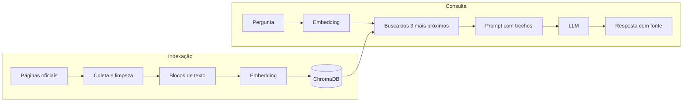

# 4. O motor de RAG

RAG significa *Retrieval-Augmented Generation*. Em vez de confiar na memória do modelo de linguagem, o sistema **busca** trechos relevantes em uma base própria e os **entrega** ao modelo junto com a pergunta. O modelo passa a ser um redator que resume o que recebeu, e não uma fonte de conhecimento.

Há duas fases: a **indexação**, feita uma vez, e a **consulta**, feita a cada pergunta.



## 4.1 O corpus: de onde vêm os textos

A pasta `susana_rag_backend/data/corpus/` tem dois arquivos `.txt` indexados, somando **27 blocos**:

| Arquivo | Blocos | Origem | Natureza |
|---|---|---|---|
| `sesdf_public.txt` | 20 | Raspagem de páginas reais de `saude.df.gov.br` e `gov.br/saude` | **Dados reais**, coletados em 06/10/2026 |
| `dados_abertos.txt` | 7 | `collect_opendata.py` | **Dados simulados** (ver abaixo) |

Distribuição por etiqueta: `DADOS_ABERTOS` 7, `EMERGENCIA` 7, `SERVICO` 5, `UNIDADE` 3, `VACINACAO` 3, `INSTITUCIONAL` 2.

O arquivo `data/sus_docs.txt` (UBS 1 Asa Sul, UBS 2 Ceilândia etc.) é um rascunho inicial com dados fictícios. Ele fica **fora** da pasta `corpus/` e **não é indexado**.

### Coleta real ([collect_corpus.py](../susana_rag_backend/ml/corpus/collect_corpus.py))

1. Lê a lista de 11 URLs em [sources.yaml](../susana_rag_backend/ml/corpus/sources.yaml), cada uma com etiqueta e título.
2. Baixa cada página com `httpx`, identificando-se como `SusanaCorpusBot/1.0` e esperando 1 s entre requisições.
3. Limpa o HTML com BeautifulSoup: remove `script`, `nav`, `footer`, menus e afins; procura o conteúdo principal; fica com parágrafos de pelo menos 40 caracteres; descarta parágrafos que são majoritariamente links.
4. Descarta a página se sobrarem menos de 200 caracteres úteis.
5. Agrupa parágrafos em blocos de até 900 caracteres (*chunking*), cortando preferencialmente em fim de frase.
6. Grava os blocos no `.txt` e um `manifest.json` com URL, data da coleta, hash SHA-256 do texto e número de blocos.

Das 11 URLs, **5 entraram no corpus** (hospitais, farmácia de alto custo, SAMU, ouvidoria, calendário de vacinação). As outras 6 falharam ou foram descartadas: é o que o `manifest.json` registra. Por isso não há, por exemplo, uma página sobre UBS no corpus real.

### "Dados abertos" simulados ([collect_opendata.py](../susana_rag_backend/ml/corpus/collect_opendata.py))

O script tenta consultar a API CKAN de `dados.df.gov.br`. Se a chamada falhar, usa um dicionário fixo escrito no próprio código (`get_mock_data`). O conteúdo atual de `dados_abertos.txt` é exatamente esse dicionário.

**Atenção para a apresentação:** esses 7 blocos são texto inventado para demonstração, e as URLs `https://dados.df.gov.br/dataset/...` exibidas como "Fonte Oficial" foram montadas pelo script a partir de nomes fictícios. Um deles diz que a "UBS 1 da Asa Sul fica na SGAS 612". Para um sistema cuja proposta é responder só com fontes oficiais, esse é o ponto mais delicado do corpus, e alguns desses blocos têm conteúdo de natureza clínica (sintomas de dengue, transmissão de HIV).

### Formato dos blocos ([corpus.py](../susana_rag_backend/app/rag/corpus.py))

```
[UNIDADE] Hospitais Regionais (parte 1)
Hospital Regional da Asa Norte – HRAN Telefone: (61) 3449-4650/4651
...
Fonte: https://www.saude.df.gov.br/hospitais
```

`parse_corpus_text` percorre o arquivo linha a linha:

- Uma linha `[ETIQUETA] Título` abre um bloco novo.
- Uma linha `Fonte: URL` define a URL do bloco e **não entra no texto**.
- As demais linhas são o corpo.

O **id** de cada bloco são os 16 primeiros caracteres do SHA-256 do seu texto. Isso torna a indexação **idempotente**: o mesmo texto gera sempre o mesmo id, então reiniciar o backend não duplica nada. O efeito colateral é que, se um texto mudar, o bloco novo é acrescentado e **o antigo nunca é removido**.

## 4.2 Embeddings ([embeddings.py](../susana_rag_backend/app/rag/embeddings.py))

Um **embedding** é um vetor que representa o significado de um texto. O modelo usado é o `paraphrase-multilingual-MiniLM-L12-v2`:

| Característica | Valor |
|---|---|
| Arquitetura | Transformer codificador (família BERT), 12 camadas |
| Parâmetros | 117,7 milhões |
| Dimensão do vetor | 384 |
| Idiomas | Mais de 50, incluindo português |
| Comprimento máximo de entrada | **128 tokens** |
| Onde roda | Na CPU/GPU local, via PyTorch |

Como funciona por dentro: o texto é dividido em tokens; cada token passa pelas 12 camadas de atenção e sai como um vetor contextualizado; os vetores de todos os tokens são combinados por **média** (*mean pooling*) em um único vetor de 384 números. O modelo foi treinado para que frases com o mesmo sentido, inclusive em idiomas diferentes, fiquem próximas.

O código pede `normalize_embeddings=True`, ou seja, todo vetor sai com **norma 1**. Com vetores de norma 1, o produto escalar é igual ao cosseno do ângulo entre eles, o que simplifica o cálculo de similaridade.

Há dois métodos, `encode_queries` e `encode_passages`. Para este modelo eles fazem a mesma coisa. A separação existe porque modelos da família E5 exigem os prefixos `query: ` e `passage: `; o código já está preparado para essa troca.

### O limite de 128 tokens

Medi os 27 blocos com o tokenizador do modelo: mínimo de 61 tokens, mediana de 149, máximo de 350. **16 dos 27 blocos passam de 128 tokens.** O que excede o limite é cortado silenciosamente antes do cálculo do vetor.

Consequência: o vetor de um bloco longo representa só o seu começo. Uma informação que esteja no final do bloco **não influencia a busca**, embora o texto completo seja entregue ao LLM se o bloco for recuperado. O *chunking* foi dimensionado em caracteres (900), sem considerar o limite do modelo em tokens. A correção é reduzir os blocos para algo em torno de 400 a 500 caracteres ou usar um modelo com janela maior.

## 4.3 Banco vetorial e busca ([retriever.py](../susana_rag_backend/app/rag/retriever.py))

O **ChromaDB** é usado em modo embutido (`PersistentClient`), gravando em disco. Cada registro guarda:

| Campo | Conteúdo |
|---|---|
| `id` | Hash do texto |
| `document` | Texto do bloco |
| `embedding` | Vetor de 384 dimensões |
| `metadata` | `source` (cabeçalho), `tag`, `url` |

A coleção chama-se `sus_df_paraphrase-multilingual-minilm-l12-v2`. O nome do modelo faz parte do nome da coleção de propósito: vetores de modelos diferentes vivem em espaços incompatíveis e não podem ser misturados.

### Distância de cosseno

A coleção é criada com `{"hnsw:space": "cosine"}`. A distância devolvida é:

```
distância = 1 − cos(θ) = 1 − (a · b) / (‖a‖ ‖b‖)
```

| Distância | Interpretação |
|---|---|
| 0 | Mesma direção: significado praticamente igual |
| 1 | Vetores ortogonais: sem relação |
| 2 | Direções opostas |

**Menor é melhor.** O índice é um **HNSW** (*Hierarchical Navigable Small World*), um grafo em camadas que encontra vizinhos aproximados em tempo logarítmico. Com 27 vetores isso é irrelevante, mas é o que permite escalar para milhões.

### Medições reais

| Pergunta | Distância do 1º | Trecho recuperado |
|---|---|---|
| "Telefone do Hospital Regional de Taguatinga" | 0,249 | Hospitais Regionais (parte 1) |
| "SAMU 192" | 0,325 | SAMU 192 (parte 1) |
| "Como faço para marcar uma consulta na UBS?" | 0,429 | Unidades Básicas de Saúde (simulado) |
| "Qual a capital da França?" | 0,814 | Ouvidoria SES-DF |
| "Como fazer bolo de chocolate?" | 1,004 | Ouvidoria SES-DF |

Perguntas dentro do domínio ficam entre 0,25 e 0,45. Perguntas sem nenhuma relação ficam entre 0,8 e 1,0.

### O limiar de 1,2 não filtra nada

A regra do código é: se a distância do melhor trecho for **maior que 1,2**, responder "não encontrei" sem chamar o LLM. Só que 1,2 está acima da distância de perguntas totalmente fora do assunto (1,004 para o bolo de chocolate). **Na prática o limiar nunca dispara.** Toda pergunta não bloqueada chega ao LLM, com três trechos que podem não ter nada a ver.

O que segura a resposta, nesses casos, é a regra 2 do prompt ("se os trechos não contêm a resposta, diga exatamente..."). Funciona, mas gasta uma chamada ao LLM e depende da obediência do modelo. Com base nas medições acima, um limiar entre **0,6 e 0,7** separaria os dois grupos. O valor padrão no construtor de `RAGPipeline` é 0,55; o 1,2 vem de `config.py`.

## 4.4 O prompt ([prompts.py](../susana_rag_backend/app/llm/prompts.py))

São duas mensagens. A de **sistema** define a persona e cinco regras:

1. Responder **somente** com base nos trechos fornecidos.
2. Se os trechos não contêm a resposta, dizer exatamente: "Não encontrei essa informação nas fontes oficiais disponíveis."
3. **Nunca** dar orientação clínica; encaminhar para UBS ou SAMU 192.
4. Português do Brasil, tom cordial, no máximo 120 palavras.
5. Indicar ao final o número do trecho usado, por exemplo `[1]`.

A de **usuário** é montada assim:

```
TRECHOS OFICIAIS:
[1] <texto do trecho 1>

[2] <texto do trecho 2>

[3] <texto do trecho 3>

PERGUNTA DO CIDADÃO: <pergunta>
```

Essa técnica chama-se **prompt fundamentado** (*grounded prompt*). A regra 3 é uma segunda barreira contra respostas clínicas, caso o guardrail falhe.

Observação sobre a citação: o LLM escreve `[1]`, `[2]` no texto, mas a "Fonte Oficial" mostrada na tela é **sempre a do trecho mais próximo** (`results[0].source`), independentemente de qual trecho o modelo usou.

## 4.5 O LLM e o Ollama ([ollama_adapter.py](../susana_rag_backend/app/llm/ollama_adapter.py))

O **Ollama** é um servidor que baixa, carrega e executa modelos de linguagem localmente e os expõe por HTTP. O modelo é o **Llama 3.1 8B** da Meta: um Transformer *decoder-only* com 8 bilhões de parâmetros, aqui na quantização **Q4_K_M**.

**Quantização** é representar os pesos com menos bits. Em vez de 16 bits por peso (cerca de 16 GB), usa-se em torno de 4 a 5 bits, o que dá 4,9 GB. Perde-se um pouco de qualidade e ganha-se a possibilidade de rodar em um computador comum.

Parâmetros enviados em cada chamada a `POST /api/chat` do Ollama:

| Parâmetro | Valor | Efeito |
|---|---|---|
| `temperature` | 0,1 | Quase determinístico: escolhe quase sempre o token mais provável |
| `seed` | 42 | Semente fixa, para respostas reprodutíveis |
| `num_ctx` | 4096 | Janela de contexto em tokens (prompt + resposta) |
| `num_predict` | 350 | Máximo de tokens na resposta |
| `keep_alive` | 30m | Mantém o modelo na memória por 30 minutos após o último uso |
| `stream` | true/false | Resposta em pedaços ou de uma vez |

**Temperatura** controla a aleatoriedade da escolha do próximo token. O modelo calcula uma probabilidade para cada token possível; temperatura baixa concentra a escolha nos mais prováveis. Para um serviço público que deve repetir o que está na fonte, baixa é a escolha certa.

Os quatro métodos do adaptador:

| Método | O que faz |
|---|---|
| `generate` | Chamada sem streaming; devolve `LLMAnswer(text, model, latency_ms)` |
| `stream` | Lê a resposta do Ollama linha a linha e faz `yield` de cada pedaço |
| `is_ready` | Consulta `/api/tags` e verifica se o modelo está instalado |
| `warm_up` | Prompt vazio para carregar o modelo na memória |

Qualquer falha (conexão recusada, timeout, JSON inválido, resposta vazia) vira a exceção `LLMUnavailable`. Tempos limite: 2 s para conectar e 12 s por operação de leitura.

## 4.6 Fallback extrativo

Se o LLM estiver indisponível, o sistema não devolve erro. Ele entrega o texto dos trechos recuperados, precedido de um aviso. O cidadão recebe a informação bruta em vez de um resumo. Esse comportamento chama-se **degradação graciosa**.

Importante: o fallback só existe porque a busca vetorial e o LLM são etapas independentes. A busca não depende do Ollama.

## 4.7 Cache semântico (classe `SemanticCache` em `retriever.py`)

Um cache comum só acerta com a mesma chave exata. O cache semântico guarda o **vetor** da pergunta e a resposta. Diante de uma pergunta nova, calcula a distância de cosseno para todas as guardadas; se a menor for ≤ 0,08, devolve a resposta salva, sem chamar o LLM.

| Característica | Valor |
|---|---|
| Onde fica | Na memória do processo (um `OrderedDict`) |
| Distância máxima para acerto | 0,08 |
| Capacidade | 512 entradas |
| Validade | 3600 s (1 hora) |
| Descarte ao encher | A entrada mais antiga sai; um acerto move a entrada para o fim (política LRU) |
| Busca | Linear, O(n), comparando com todas |

Limitações: perde tudo ao reiniciar; não é compartilhado entre processos; a busca linear não escala. O próprio código o descreve como "placeholder para Redis Vector Search". Como já dito em [03](03-backend-api.md), **o cache só é usado em `/api/chat`**, não na rota de streaming que a tela usa.

Um detalhe do `pipeline.query`: respostas "não encontrei" também são guardadas no cache.

## 4.8 O orquestrador ([pipeline.py](../susana_rag_backend/app/rag/pipeline.py))

`RAGPipeline.query(message)` executa em sequência:

1. Calcula o embedding da pergunta.
2. Consulta o cache; em caso de acerto, devolve na hora.
3. Busca os 3 trechos mais próximos.
4. Se não houver trecho ou a distância for maior que o limiar, devolve "não encontrei".
5. Chama `llm.generate`; se lançar `LLMUnavailable`, monta o fallback extrativo.
6. Guarda no cache.
7. Registra no MLflow: a pergunta (até 200 caracteres), latência total, latência do LLM, se o LLM foi usado, distância do melhor trecho e fonte.

O item 7 contraria o contrato do próprio projeto (`openspec/.../contracts.md`, seção 5), que manda **nunca registrar a pergunta completa**, apenas um hash dela. Em um sistema de saúde, a pergunta de um cidadão pode conter dado pessoal sensível.
