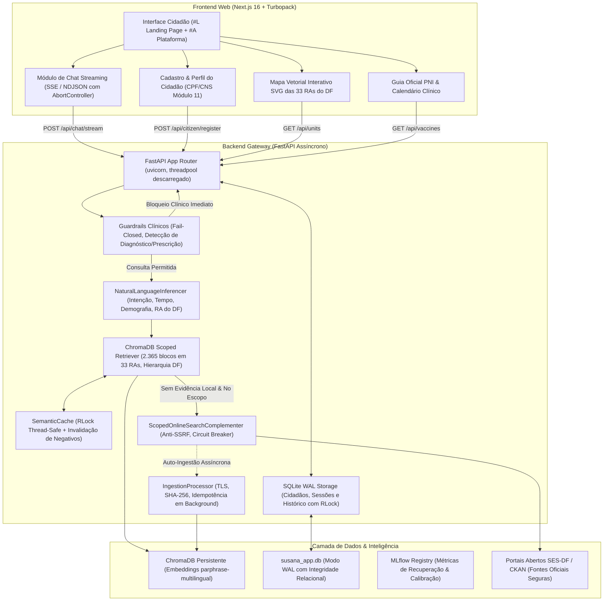
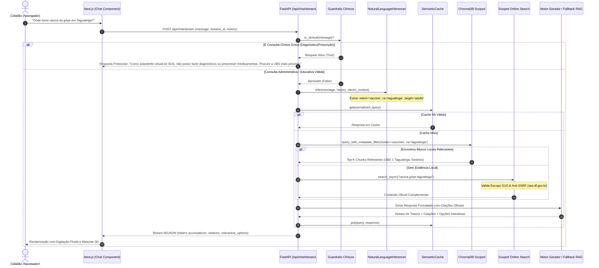

# 🏛️ Arquitetura e Funcionamento do Sistema — SUS Digital (Projeto Suzanna)

---

## 📋 1. Visão Geral do Sistema

O **SUS Digital (Projeto Suzanna)** é uma plataforma unificada de inteligência em saúde pública desenvolvida para o ecossistema do Distrito Federal (SES-DF / Ministério da Saúde). O sistema combina um assistente virtual conversacional baseado em **RAG (Retrieval-Augmented Generation)**, governança clínica estrita contra desinformação médica, catálogo geográfico interativo de unidades de saúde em 33 Regiões Administrativas (RAs) e gestão do ciclo de vida vacinal do cidadão (PNI).

---

## 🔄 2. Ciclo de Vida da Requisição Conversacional (End-to-End)

Quando um cidadão envia uma mensagem para a Suzanna (seja via texto digitado ou chips de perguntas rápidas), o fluxo obedece a um pipeline de segurança em camadas e resposta em streaming:

---

## 🧠 3. Componentes Centrais do Backend

### 3.1. Natural Language Inferencer (`app/rag/nlu.py`)
- **Latência Ultrarrápida (< 2ms):** Motor baseado em expressões regulares compiladas e normalização fonética/lexical sem chamada de rede externa.
- **Resolução Geográfica das 33 Regiões Administrativas do DF:** Reconhece nomes de RAs, vilas, setores e quadras (ex: "Ceilândia", "Sol Nascente", "P Sul", "Asa Norte", "Águas Claras"), mapeando para IDs unificados.
- **Detecção de Ciclos de Vida Demográficos:**
  - `idoso`: Prioridade para vacinação influenza, controle de hipertensão e diabetes.
  - `gestante`: Triagem pré-natal, vacina dTpa e testes rápidos.
  - `recem_nascido` e `crianca`: Teste do pezinho, BCG, pentavalente e puericultura.
- **Proteção contra *Bot Poisoning*:** Filtra mensagens originadas pelo bot no histórico para que orientações anteriores da Suzanna não contaminem a intenção real do cidadão.

### 3.2. Scoped Retriever & Hierarchical Fallback (`app/rag/retriever.py`)
- **Corpus Estruturado com 2.365 Blocos:** Todos os blocos no ChromaDB contêm metadados estruturados:
  - `ra`: Identificador da Região Administrativa (ex: `ceilandia`, `taguatinga`, `geral_df`).
  - `cluster`: Categoria temática (`unidades_saude`, `vacinas`, `especialidades`, `campanhas`, `faq`).
  - `tipo_unidade`: UBS, UPA, Hospital Regional ou Policlínica.
  - `servicos`: Lista normalizada de procedimentos oferecidos.
- **Busca Híbrida Filtrada:** Aplica filtro `$or` no ChromaDB combinando a RA específica solicitada com a base regional de cobertura ampla (`geral_df`).
- **Semantic Cache com Thread-Safety (`RLock`):** Cache de consultas frequentes protegido por trava recursiva, com método cirúrgico `invalidate_negatives()` que limpa respostas de abstenção anteriores assim que novos dados oficiais são ingeridos.

### 3.3. Scoped Online Search Complementer (`app/rag/online_search.py`)
- **Portão Rigoroso de Escopo:** Exige co-ocorrência obrigatória de termos contextuais da saúde do DF (ex: vacina, UBS, consulta, dengue) para impedir que buscas cotidianas (ex: Detran, cinema) vazem para redes externas.
- **Defesa Profunda contra SSRF (Server-Side Request Forgery):**
  - Whitelist restrita a domínios oficiais: `saude.df.gov.br`, `df.gov.br`, `gov.br`, `fiocruz.br`.
  - Bloqueio imediato de loopback (`localhost`, `127.0.0.1`), endereços IPv4/IPv6 privados (RFC 1918) e domínios municipais fora do DF.
- **Concorrência Segura & ThreadPool Persistente:** Auto-ingestão em background desacoplada através de `ThreadPoolExecutor` persistente para garantir que falhas de rede externa nunca degradem a experiência do cidadão.
- **Circuit Breaker:** Interrompe tentativas consecutivas caso portais externos estejam instáveis, registrando alertas estruturados.

### 3.4. Guardrails Clínicos Defensivos (`app/rag/guardrails.py`)
- **Arquitetura Dual (ML + Regex Heurístico):**
  1. *Filtro Rápido Heurístico:* Identifica padrões de automedicação, posologia e dosagem ("quantas gotas", "quantos mg", "qual remédio tomar").
  2. *Classificador Supervisionado:* Modelo treinado com calibração de probabilidades para detectar pedidos de diagnóstico e avaliação de sintomas graves.
- **Comportamento Fail-Closed:** Qualquer erro ou dúvida no classificador resulta no bloqueio preventivo da resposta e orientação para comparecimento à UBS ou acionamento do SAMU 192.

### 3.5. Persistência Relacional SQLite em Modo WAL (`app/citizen/` e `app/chat_sessions/`)
- **Banco de Dados `susana_app.db`:**
  - Tabela `citizens`: Cadastro completo com validação de CPF (Módulo 11) e CNS (DATASUS), data de nascimento, faixa etária calculada e flag de gestante.
  - Tabela `chat_sessions`: Sessões de conversa independentes com títulos dinâmicos e prévia de mensagem.
  - Tabela `chat_messages`: Histórico sequencial com remetente, fontes de citação e opções interativas.
- **Concorrência WAL & RLock:** Utiliza `PRAGMA journal_mode=WAL` e `PRAGMA synchronous=NORMAL`, permitindo leituras ilimitadas simultâneas sem bloqueio de escrita.

---

## 🎨 4. Frontend da Aplicação (`susana-ui`)

O frontend é construído com **Next.js 16 (App Router)** e empacotado via **Turbopack**:

1. **Landing Page Conceitual (`#L`):**
   - Apresentação da mascote Suzanna em 3D com física de flutuação orgânica (`@keyframes fl`).
   - Cards de vidro líquido com desfoque de `22px` e saturação de `170%`.
   - Barra de navegação flutuante em formato de pílula.
2. **Área da Plataforma (`#A`):**
   - **Menu Lateral Sticky (Desktop) / Bottom Navigation Pill (Mobile):** Alternância entre 5 abas funcionais (`Início`, `Assistente`, `Serviços`, `Monitoramento`, `Histórico`).
   - **Gerenciador de Multi-Sessões de Chat:** Permite criar novas conversas, navegar por históricos passados e retomar atendimentos.
   - **Mapa de Unidades Interativo:** Conectado à API com 346 unidades de saúde do DF, projeção de coordenadas SVG nos eixos rodoviários e cartão retrátil com horários e serviços.
   - **Guia de Vacinação PNI:** Tabela oficial organizada por fases da vida (Recém-nascido, Criança, Adolescente, Adulto, Idoso e Gestante).
   - **Monitoramento Epidemiológico:** Spline cúbica vetorial SVG com histórico semanal de casos de dengue no DF e barras comparativas por RA.

---

## 🛡️ 5. Resumo dos Contratos de API (Endpoints Principais)

| Método | Endpoint | Descrição / Payload Principal |
| :--- | :--- | :--- |
| `POST` | `/api/chat` | Chat síncrono com inferência NLU, busca vetorial e guardrails. |
| `POST` | `/api/chat/stream` | Chat em streaming NDJSON/SSE com cancelamento via AbortController. |
| `POST` | `/api/citizen/register` | Cadastro do cidadão com validação de CPF/CNS e cálculo de idade. |
| `GET` | `/api/citizen/profile/{id}`| Recuperação de perfil cadastrado e orientações PNI personalizadas. |
| `GET` | `/api/chat-sessions` | Listagem de conversas anteriores do cidadão ativo. |
| `GET` | `/api/units` | Catálogo das 346 unidades de saúde com filtros por RA e tipo de unidade. |
| `GET` | `/api/vaccines` | Guia de vacinas do PNI com filtros por faixa etária ou gravidez. |
| `POST` | `/api/ingestion/webhook` | Webhook autenticado com token HMAC para ingestão incremental. |
| `GET` | `/health` | Verificação de integridade operacional do gateway e do ChromaDB. |

---

*Documento de Arquitetura Homologado · Projeto Suzanna (SUS Digital).*
