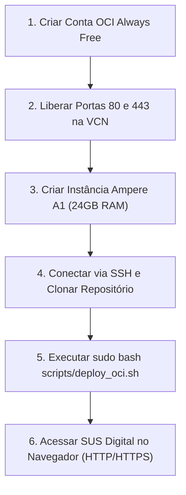

# 🏛️ Guia Definitivo de Deploy na Oracle Cloud (OCI Always Free)
## *SUS Digital (Projeto Suzanna) — 100% Gratuito, 24 GB RAM e LGPD no Brasil*

---

## 📋 Visão Geral

Este guia ensina o passo a passo completo para colocar a plataforma **SUS Digital (Projeto Suzanna)** no ar de forma **vitalícia e 100% gratuita** utilizando o programa oficial **Always Free da Oracle Cloud Infrastructure (OCI)**.

### Por que esta é a melhor opção para o SUS Digital?
- **24 GB de Memória RAM e 4 OCPUs (Processadores ARM Ampere A1)** dedicados sem custo;
- **200 GB de Armazenamento SSD NVMe Gratuito** (capacidade para todo o diretório de saúde do DF, prontuários de cidadãos e modelos de IA);
- **Datacenter no Brasil (São Paulo / Vinhedo):** Atendimento estrito à **LGPD** para dados de saúde pública e latência de rede mínima para o Distrito Federal (< 15ms);
- **IP Público Fixo e Tráfego Gratuito**;
- **SSL Automático (HTTPS):** Certificados emitidos e renovados sozinhos pelo Caddy.



---

## 🚀 Passo 1: Criar a Conta na Oracle Cloud

1. Acesse o portal oficial: **[oracle.com/cloud/free](https://www.oracle.com/cloud/free/)** e clique em **Start for free**.
2. Preencha seus dados de cadastro (País: *Brazil*).
3. **Seleção Crítica da Home Region:**
   - Escolha **Brazil East (Sao Paulo)** ou **Brazil Southeast (Vinhedo)**.
   - *Nota:* A Home Region é onde seus recursos gratuitos ficam alocados permanentemente e garante conformidade com a LGPD.
4. Conclua a verificação de identidade com um cartão de crédito internacional (a Oracle faz uma cobrança de teste de ~$1 que é estornada na hora; **nenhum valor é cobrado no plano Always Free**).

---

## 🌐 Passo 2: Configurar a Rede e o Firewall da OCI (VCN)

Para que a internet consiga acessar o site, precisamos abrir as portas HTTP (80) e HTTPS (443) no painel da Oracle:

1. No menu lateral do console da Oracle, vá em **Networking** > **Virtual Cloud Networks**.
2. Clique na sua VCN (geralmente criada automaticamente como `vcn-...`).
3. No menu esquerdo, clique em **Security Lists** e selecione a **Default Security List for vcn-...**.
4. Clique em **Add Ingress Rules** e adicione as regras abaixo:
   - **Regra HTTP (Porta 80):**
     * *Source CIDR:* `0.0.0.0/0`
     * *IP Protocol:* `TCP`
     * *Destination Port Range:* `80`
     * *Description:* `HTTP Traffic - SUS Digital`
   - **Regra HTTPS (Porta 443):**
     * *Source CIDR:* `0.0.0.0/0`
     * *IP Protocol:* `TCP`
     * *Destination Port Range:* `443`
     * *Description:* `HTTPS Traffic - SUS Digital SSL`
5. Clique em **Add Ingress Rules**.

---

## 🖥️ Passo 3: Criar a Máquina Virtual (Compute Instance)

1. No menu lateral da Oracle, vá em **Compute** > **Instances** e clique em **Create instance**.
2. **Nome da Instância:** `susana-sus-digital`.
3. **Placement:** Mantenha o padrão da região de São Paulo.
4. **Image and Shape (Etapa Crucial):**
   - Clique em **Change Image**: Selecione **Ubuntu** e escolha a versão **Ubuntu 24.04** ou **Ubuntu 22.04 Minimal (aarch64)**.
   - Clique em **Change Shape**:
     * Selecione **Ampere (ARM Processor)**.
     * Marque `VM.Standard.A1.Flex`.
     * Ajuste os seletores para o máximo do Always Free:
       - **OCPUs:** `4`
       - **Memory (GB):** `24`
     * Observe o selo verde: **"Always Free Eligible"**.
5. **Add SSH Keys:**
   - Selecione **Generate a key pair for me** e clique em **Save private key** (salve o arquivo `.key` no seu computador).
6. **Boot Volume:**
   - Deixe o tamanho em **100 GB** ou até **200 GB** (o limite gratuito é 200 GB somados).
7. Clique no botão inferior **Create**.
8. Em cerca de 1 a 2 minutos, o status mudará para verde (**RUNNING**).
9. Copie o **Public IP Address** (ex: `129.148.x.x`).

---

## 🔑 Passo 4: Conectar via SSH e Executar o Deploy Automatizado

Abra o terminal do seu computador (macOS / Linux ou PowerShell no Windows):

### 1. Conectar via SSH
```bash
# Ajuste as permissões da chave privada baixada
chmod 400 caminho/para/sua_chave.key

# Conecte-se na máquina (o usuário padrão do Ubuntu é 'ubuntu')
ssh -i caminho/para/sua_chave.key ubuntu@<SEU_IP_PUBLICO>
```

---

### 2. Clonar o Repositório e Rodar o Deploy
Dentro do terminal da máquina da Oracle Cloud, execute os seguintes comandos:

```bash
# Clonar o repositório na branch homologacao
git clone -b homologacao https://github.com/Andre-Atlas/SUSANNA-HEALTHCHECK.git susana

# Entrar na pasta do projeto
cd susana

# Executar o script de provisionamento automatizado com sudo
sudo bash scripts/deploy_oci.sh
```

### O que o script `deploy_oci.sh` faz sozinho:
- Atualiza os pacotes do Ubuntu;
- Instala o Docker Engine e o plugin Docker Compose;
- **Resolve o firewall interno da Oracle:** Abre as portas 80 e 443 nas tabelas `iptables` do Ubuntu (o erro mais comum em servidores da Oracle);
- Compila os contêineres Docker multi-stage otimizados para ARM64;
- Inicia o Frontend Next.js 16, o Backend FastAPI e o Caddy Proxy Reverso em segundo plano;
- Verifica a integridade dos serviços e exibe o link de acesso.

---

## 🔒 Passo 5: Configurar Domínio e Certificado HTTPS Gratuito

Se você quiser que o site tenha um cadeado verde (**HTTPS**) em vez de acessar por `http://<IP_PUBLICO>`:

### Opção A: Domínio Dinâmico Gratuito (DuckDNS)
1. Crie uma conta gratuita em **[duckdns.org](https://www.duckdns.org)**;
2. Crie um subdomínio (ex: `susana-sus.duckdns.org`) apontando para o seu **IP Público da Oracle**;
3. No servidor da Oracle, configure a variável no arquivo `.env`:
   ```bash
   echo "DOMAIN=susana-sus.duckdns.org" > .env
   sudo docker compose up -d --force-recreate caddy
   ```
4. O Caddy emitirá o certificado SSL automaticamente em menos de 10 segundos via Let's Encrypt!

### Opção B: Domínio Curinga Gratuito Imediato (nip.io)
Se você não quiser criar conta em nenhum serviço de DNS, pode usar o serviço gratuito `nip.io`:
```bash
# Substitua pelo seu IP real com hífens ou pontos
echo "DOMAIN=app.<SEU_IP_PUBLICO>.nip.io" > .env
sudo docker compose up -d --force-recreate caddy
```
Acesse no navegador: **`https://app.<SEU_IP_PUBLICO>.nip.io`** com HTTPS nativo!

---

## 🧠 Passo 6 (Opcional): Rodar o Llama 3.1 8B Localmente na RAM da OCI

Graças aos **24 GB de memória RAM gratuita** da máquina Ampere A1, você pode rodar o **Ollama com o Llama 3.1 8B quantizado diretamente na máquina virtual**, sem precisar pagar por GPUs:

```bash
# Instalar o Ollama no Ubuntu da OCI
curl -fsSL https://ollama.com/install.sh | sh

# Baixar e inicializar o Llama 3.1 8B
ollama run llama3.1:8b
```
O backend da Susana conectará automaticamente no Ollama em `http://host.docker.internal:11434`!

---

## 🛠️ Comandos Úteis de Manutenção

| Ação | Comando |
| :--- | :--- |
| **Ver logs em tempo real** | `sudo docker compose logs -f` |
| **Ver logs apenas do backend** | `sudo docker compose logs -f backend` |
| **Verificar status dos containers**| `sudo docker compose ps` |
| **Reiniciar todos os serviços** | `sudo docker compose restart` |
| **Atualizar para nova versão** | `git pull origin homologacao && sudo docker compose build && sudo docker compose up -d` |
| **Parar a aplicação** | `sudo docker compose down` |

---
*SUS Digital · Implantação Homologada na Oracle Cloud Always Free.*
