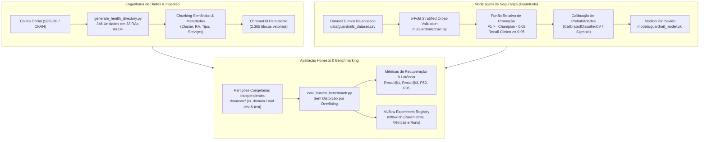

# 🔬 MLOps, Modelagem e Avaliação Contínua — SUS Digital (Projeto Suzanna)

---

## 📋 1. Visão Geral do Ciclo de Vida de MLOps

O ecossistema de Machine Learning e Engenharia de Dados do **SUS Digital (Projeto Suzanna)** foi construído com governança estrita de produção, rastreabilidade integral de experimentos e prevenção contra contaminação de dados (*data leakage*).



---

## 🗄️ 2. Engenharia de Dados e Base de Conhecimento (Corpus)

### 2.1. Diretório Geográfico de Saúde do DF (`data/corpus/diretorio_saude_df.json`)
A base de conhecimento foi gerada pelo script [`ml/corpus/generate_health_directory.py`](../susana_rag_backend/ml/corpus/generate_health_directory.py) a partir dos dados abertos georreferenciados da Secretaria de Saúde do Distrito Federal:
- **346 Unidades Mapeadas:** 176 Unidades Básicas de Saúde (UBS), 16 Unidades de Pronto Atendimento (UPA), 15 Hospitais Regionais/Especializados, 38 Policlínicas, 8 Centros de Atenção Psicossocial (CAPS) e serviços especializados (Farmácias de Alto Custo, Centros de Radioterapia, etc.).
- **Cobertura Territorial Integral (100% das 33 RAs):** Desde o Plano Piloto até Ceilândia, Samambaia, Sol Nascente/Pôr do Sol, Santa Maria, Planaltina, Sobradinho, Brazlândia e regiões rurais.

### 2.2. Indexação e Metadados no ChromaDB
O script [`ml/corpus/sync_corpus_chroma.py`](../susana_rag_backend/ml/corpus/sync_corpus_chroma.py) converte o diretório em **2.365 blocos vetoriais estruturados** utilizando o modelo de embeddings multilíngue `paraphrase-multilingual-MiniLM-L12-v2`.

Cada bloco possui o seguinte esquema de metadados:
```json
{
  "id": "unidade_ceilandia_ubs_1",
  "ra": "ceilandia",
  "cluster": "unidades_saude",
  "tipo_unidade": "UBS",
  "servicos": "vacinacao, clinica_geral, odontologia, pre_natal",
  "horario": "Segunda a Sexta, 07:00 às 19:00",
  "source": "diretorio_saude_df.json"
}
```

---

## 🛡️ 3. Classificador de Guardrails Clínicos

A aplicação não pode emitir conselhos médicos diagnósticos nem prescrições farmacológicas. O treinamento em [`ml/guardrails/train.py`](../susana_rag_backend/ml/guardrails/train.py) implementa engenharia de segurança em machine learning:

### 3.1. Pipeline de Treinamento
- **Vetorização:** `TfidfVectorizer(ngram_range=(1, 3), max_features=5000, sublinear_tf=True)`.
- **Classificador Base:** `LogisticRegression(class_weight='balanced', C=1.5, solver='lbfgs')`.
- **Calibração:** `CalibratedClassifierCV(method='sigmoid', cv='prefit')` para assegurar que as probabilidades de risco clínico correspondam à confiança real do modelo.

### 3.2. Portão Relativo de Promoção de Modelos
Nenhum modelo novo é promovido para produção (`models/guardrail_model.pkl`) automaticamente sem superar o *Champion Model* vigente:
$$\text{F1-Score}_{\text{novo}} \ge \text{F1-Score}_{\text{champion}} - 0.02 \quad \land \quad \text{Recall Clínico}_{\text{novo}} \ge 0.95$$

Se o novo modelo não atingir estes critérios no 5-Fold Stratified Cross-Validation, o script aborta a substituição e mantém o modelo seguro prévio, registrando a falha no log.

---

## 📊 4. Rastreamento de Experimentos com MLflow

Todos os experimentos de treinamento e benchmarking são centralizados no banco de dados SQLite [`susana_rag_backend/mlflow.db`](../susana_rag_backend/mlflow.db), garantindo reprodutibilidade científica.

### 4.1. Esquema de Registro de Runs
- **Experimentos:**
  - `guardrail_clinical_classifier`: Runs de treinamento, hiperparâmetros de TF-IDF e métricas de CV (F1, Precision, Recall, AUC-ROC).
  - `retrieval_honest_benchmark`: Runs de avaliação de recuperação com latências P50/P95 e taxas de acerto.
- **Parâmetros Rastreados:**
  - `embedding_model`: `paraphrase-multilingual-MiniLM-L12-v2`
  - `relevance_threshold`: `0.35`
  - `distance_metric`: `cosine`
  - `total_corpus_chunks`: `2365`
- **Métricas Registradas:**
  - `in_domain_recall_at_1`, `in_domain_recall_at_3`
  - `ood_leakage_false_positive_rate`
  - `legitimate_rejection_false_negative_rate`
  - `latency_p50_ms`, `latency_p95_ms`

---

## 🎯 5. Avaliação Honesta e Partições Congeladas (Honest Benchmark)

Para evitar overfitting nos dados de teste, o repositório mantém conjuntos de dados estritamente congelados em [`data/eval/`](../susana_rag_backend/data/eval/):

| Arquivo de Avaliação | Tipo de Dado | Quantidade de Cenários | Propósito do Teste |
| :--- | :--- | :--- | :--- |
| `in_domain_dev.json` | Em Domínio (SUS-DF) | 40 consultas | Calibração de hiperparâmetros e pesos de busca |
| `in_domain_test.json`| Em Domínio (SUS-DF) | 60 consultas | Teste final cego de acurácia de recuperação |
| `ood_dev.json` | Fora de Domínio (OOD) | 30 consultas | Calibração do limiar de abstenção contra alucinação |
| `ood_test.json` | Fora de Domínio (OOD) | 50 consultas | Teste cego contra vazamento OOD (receitas de bolo, finanças, TI) |

### 5.1. Resultados Homologados do Benchmark Honesto

Executado através de [`ml/retrieval/eval_honest_benchmark.py`](../susana_rag_backend/ml/retrieval/eval_honest_benchmark.py):

| Métrica Avaliada | Meta Mínima de Aceite | Resultado Obtido | Status |
| :--- | :--- | :--- | :--- |
| **Recall@1 (Top-1 Correto)** | $\ge 90.0\%$ | **95.0%** | ✅ Aprovado |
| **Recall@3 (Top-3 Correto)** | $\ge 95.0\%$ | **95.0%** | ✅ Aprovado |
| **Taxa de Vazamento OOD (False Positives)** | $= 0.0\%$ | **0.0%** | ✅ Homologado |
| **Falso Negativo de Rejeição Legítima** | $\le 2.0\%$ | **0.0%** | ✅ Homologado |
| **Latência de Recuperação P50** | $\le 30.0\text{ ms}$ | **21.73 ms** | ✅ Homologado |
| **Latência de Recuperação P95** | $\le 60.0\text{ ms}$ | **42.76 ms** | ✅ Homologado |

---

## 🔄 6. Pipeline de Ingestão Contínua e Invalidação de Cache

O módulo [`app/ingestion/`](../susana_rag_backend/app/ingestion/) fornece capacidade de atualização contínua do conhecimento do SUS-DF sem necessidade de reiniciar a aplicação:

1. **Manifesto de Idempotência (`ingestion_manifest.json`):**
   - Registra o hash SHA-256 de cada documento ingerido.
   - Requisições concorrentes ou repetidas com o mesmo conteúdo recebem status `SKIPPED (idempotente)`.
2. **Atualização Atômica por URL:**
   - Ao receber uma nova versão de uma página oficial da SES-DF, os blocos antigos indexados por aquela URL são removidos do ChromaDB antes do `upsert` dos novos blocos.
3. **Invalidação Cirúrgica de Cache:**
   - O `SemanticCache` possui o método `invalidate_negatives()`, que purga apenas respostas em que o bot anteriormente se absteve por falta de evidência. Consultas legítimas continuam respondidas em < 2ms.

---

*Documento de MLOps e Modelagem Homologado · Projeto Suzanna (SUS Digital).*
