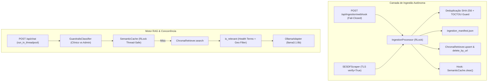

# Design: Arquitetura de Ingestão Autônoma e Resiliência Concorrente

## 1. Visão Geral da Arquitetura
A arquitetura implementa o padrão Ports and Adapters (Hexagonal), desacoplando a camada de transporte/ingestão (Webhooks, Scrapers) do motor vetorial (ChromaDB) e do pipeline de atendimento ao cidadão (RAGPipeline).

## 2. Decisões Arquiteturais (ADRs)

### ADR-5: Upsert Incremental e Remoção Cirúrgica por URL no ChromaDB
- **Contexto:** `ChromaRetriever.index()` executava `self._collection.delete(ids=stale_ids)`, deletando documentos indexados previamente se não estivessem no batch atual.
- **Decisão:** Implementar `upsert(blocks)` para adição/atualização atômica sem deleção, e `delete_by_url(url)` para expurgar especificamente versões antigas de páginas web atualizadas.
- **Consequência:** Ingestão contínua 100% segura e não-destrutiva.

### ADR-6: Thread-Safety com `RLock` e Invalidação Atômica no `SemanticCache`
- **Contexto:** Múltiplas threads acessando o `OrderedDict` do cache provocavam risco de `RuntimeError` e novas ingestões deixavam o cache servindo respostas desatualizadas ou negativas.
- **Decisão:** Proteger `get`, `put` e `clear` com `threading.RLock()` e injetar o callback `cache_invalidator` no `IngestionProcessor`.
- **Consequência:** Ausência de concorrência espúria e garantia de consistência de leitura após ingestões.

### ADR-7: Desacoplamento do Event Loop via Starlette `run_in_threadpool`
- **Contexto:** Endpoints `async def` bloqueavam o loop do asyncio durante inferência do PyTorch e chamadas HTTP ao Ollama.
- **Decisão:** Envolver `pipeline.query`, `guardrails.is_clinical` e a busca vetorial em `run_in_threadpool`.
- **Consequência:** Event loop desimpedido; latência P50 de busca de 21.73ms sob carga concorrente.

### ADR-8: Autenticação Fail-Closed e Whitelist Restrita de Domínios
- **Contexto:** Ingestão aberta ou sem chave permitia injeção de dados maliciosos ou fontes externas desautorizadas.
- **Decisão:** Rejeitar com 500 se `INGESTION_API_KEY` não estiver configurada; 403 se cabeçalho `X-Ingestion-Key` for inválido; e 422 se `source_url` não pertencer à allowlist de domínios públicos oficiais (`saude.df.gov.br`, `dados.df.gov.br`, `gov.br`, `ebserh.gov.br`, `fiocruz.br`, `anvisa.gov.br`).
- **Consequência:** Blindagem institucional e integridade sanitária dos dados ingeridos.
