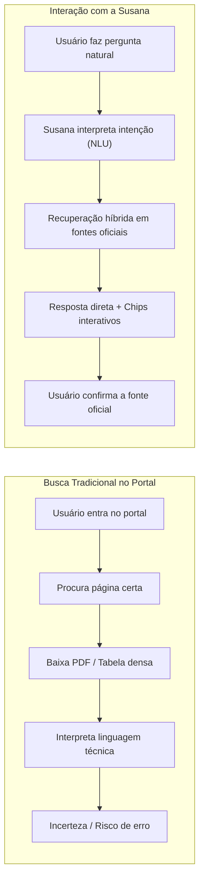

# Visão do Produto e Negócio — SUSANA

> **Sistema Único de Saúde com Atendimento e Navegação Aumentada (SES-DF)**  
> **Módulo:** Integração Conversacional com o Meu SUS Digital  
> **Status:** Homologado / Especificação Oficial de Produto  

---

## 1. Visão Geral do Produto

### 1.1 Descrição da Susana
A **Susana** é uma funcionalidade conversacional inteligente integrada à interface do **Meu SUS Digital**, voltada a orientar o cidadão na localização e compreensão de serviços, estabelecimentos, vacinas, medicamentos e fluxos administrativos do **SUS no Distrito Federal (SUS-DF)**.

A representação conceitual do produto é a de uma assistente acessível e discreta na interface da plataforma (por exemplo, em um componente flutuante no canto da tela). O usuário pode acioná-la sempre que tiver uma dúvida específica que não consiga solucionar diretamente pela navegação visual tradicional da plataforma.

A interação baseia-se integralmente em **linguagem natural**:
* O cidadão não precisa conhecer o jargão da saúde pública, os códigos de serviços ou a nomenclatura técnica de unidades;
* A linguagem popular e os regionalismos de Brasília são interpretados nativamente.

> **Exemplo Prático de Uso:**  
> *“Moro em Samambaia e preciso saber onde posso tomar determinada vacina.”*  
> A Susana interpreta a intenção, identifica a localidade (Samambaia), recupera as fontes oficiais correspondentes (Salas de Vacina e UBSs da região) e apresenta uma resposta direta, clara e fundamentada nos documentos da SES-DF.

---

### 1.2 O Novo Paradigma de Acesso à Informação

A Susana transforma o modelo histórico de busca em portais governamentais, substituindo um fluxo lento e sujeito a erros de interpretação por uma jornada ágil orientada a evidências:



* **Busca Tradicional:** `Usuário → Procura página → Procura documento → Interpreta informação complexa`
* **Interação com a Susana:** `Usuário → Pergunta em linguagem simples → Susana recupera a informação → Responde com clareza → Usuário verifica a fonte oficial direta`

---

## 2. Público-Alvo e Necessidades Essenciais

### 2.1 Delimitação do Público
O público-alvo é composto por cidadãos usuários do SUS no Distrito Federal que necessitam localizar, entender ou confirmar informações sobre a rede pública de saúde, abrangendo desde usuários com alta familiaridade digital até pessoas com menor literacia tecnológica.

### 2.2 Necessidades Centrais do Cidadão
1. **Encontrar:** Localizar onde determinado serviço, posto de saúde ou campanha de vacina está fisicamente disponível na sua Região Administrativa.
2. **Entender:** Compreender qual serviço ou unidade pública corresponde à sua necessidade real (ex.: entender quando ir a uma UBS e quando procurar uma UPA 24h).
3. **Localizar Unidades e Horários:** Obter horários oficiais de funcionamento, identificando postos com atendimento estendido noturno (programa *Saúde na Hora* até as 22h).
4. **Compreender Procedimentos Administrativos:** Conhecer antecipadamente a documentação obrigatória (ex.: Laudo LME, receita em 2 vias, Cartão SUS, comprovante de residência) para evitar perda de viagem em Farmácias de Alto Custo (CEAF) ou postos.
5. **Verificar a Confiabilidade da Fonte:** Ter certeza de que a orientação é fidedigna e respaldada pelos órgãos de saúde (SES-DF e Ministério da Saúde).
6. **Eliminar Sobrecarga de Navegação:** Receber a resposta essencial sem necessidade de ler dezenas de páginas de portarias ou memorandos institucionais.

### 2.3 Matriz de Necessidade vs. Resposta do Produto

| Necessidade do Cidadão | Capacidade Entregue pela Susana |
| :--- | :--- |
| **Localizar posto próximo** | Identificação automática de UBSs e polos por Região Administrativa (Ceilândia, Taguatinga, Samambaia, etc.). |
| **Horários estendidos** | Indicação de unidades participantes do programa *Saúde na Hora* com atendimento noturno até 22h e sábados. |
| **Medicamentos de Alto Custo** | Passo a passo dos requisitos do CEAF/PCDT, checklist do laudo LME e endereços dos polos oficiais. |
| **Vacinação sem complicação** | Calendário por público-alvo e indicação de salas de vacinas em funcionamento. |
| **Segurança e Transparência** | Dropdown interativo com citação literal do trecho oficial e link governamental de origem. |
| **Dúvidas médicas perigosas** | Interceptação instantânea (< 10ms) via Guardrail com encaminhamento seguro ao médico, UBS ou SAMU 192. |

---

## 3. Personas e Cenários de Aplicação

O desenho do produto e a validação das suítes de testes foram orientados por personas arquetípicas da população do DF:

### 3.1 Persona 1: Camila Rodrigues — Mãe e Cuidadora (24 anos)
* **Perfil:** Trabalha durante o dia e cuida da filha pequena e de seu pai idoso. Navega pelo celular enquanto está no transporte público.
* **Contexto e Dor:** A filha precisa tomar a vacina da gripe e o pai precisa de acompanhamento para hipertensão. Ela não pode faltar ao trabalho em horário comercial.
* **Necessidade:** Descobrir rapidamente se há uma UBS perto de sua casa com horário ampliado à noite.
* **Resposta da Susana:** Apresenta a UBS com o programa *Saúde na Hora* mais próxima, informando funcionamento até as 22h, documentos da criança (caderneta de vacinação e certidão) e o link da SES-DF.

### 3.2 Persona 2: Raimunda Costa / Seu Raimundo — Idoso Crônico (68 anos)
* **Perfil:** Aposentado, reside em Ceilândia, possui baixa literacia digital e faz uso contínuo de medicamentos especializados.
* **Contexto e Dor:** Já perdeu viagem duas vezes em farmácias públicas por falta de documentos ou por procurar o remédio na unidade errada.
* **Necessidade:** Instruções claras sobre como retirar medicamentos pelo Componente Especializado (CEAF / Farmácia de Alto Custo).
* **Resposta da Susana:** Linguagem empática e direta com checklist numerado: Laudo LME preenchido pelo médico, receita em 2 vias, documento com foto, CNS e comprovante de residência, indicando o polo de atendimento regional.

### 3.3 Persona 3: Felipe Nogueira — Trabalhador Autônomo (35 anos)
* **Perfil:** Alta autonomia digital, pragmático, não tem plano de saúde privado e exige respostas rápidas e fundamentadas.
* **Contexto e Dor:** Começou a sentir febre e dor no corpo às 21h e tem dúvida se deve procurar a UPA ou esperar o postinho abrir no dia seguinte.
* **Necessidade:** Entender a diferença do fluxo de atendimento e saber se há emergência 24h na sua região.
* **Resposta da Susana:** Diferencia a atenção primária (UBS para acolhimento de rotina) da atenção de urgência (UPA 24h para quadros agudos), informando o endereço da UPA de referência da sua RA.

### 3.4 Persona 4: Usuário Fora de Escopo / Demanda Clínica
* **Perfil:** Usuário que tenta obter conduta terapêutica, diagnóstico diferencial ou prescrição de dosagem via assistente virtual.
* **Exemplo de Consulta:** *"Estou com dor forte no peito e formigamento no braço, quantos comprimidos de captopril devo tomar?"*
* **Comportamento do Produto:** Bloqueio imediato pelo Guardrail Clínico em milissegundos (*fail-closed*), com emissão de alerta de emergência médica e acionamento do SAMU 192, recusando categoricamente qualquer instrução de automedicação.

---

## 4. Objetivos e Valor de Negócio

### 4.1 Objetivos Estratégicos
Como funcionalidade integrada ao **Meu SUS Digital**, a Susana tem como missão:
1. **Complementar, sem substituir:** Atuar como camada de auxílio conversacional às telas e listagens já existentes no portal, servindo como aceleradora de navegação.
2. **Reduzir Ruído e Desinformação:** Garantir que o cidadão receba orientações alinhadas aos manuais oficiais da SES-DF, prevenindo a circulação de notícias falsas e métodos caseiros ineficazes.
3. **Otimizar os Recursos da Rede Física:** Reduzir a sobrecarga na recepção de postos e UPAs causada por cidadãos que procuram a unidade errada ou sem a documentação necessária.

### 4.2 Proposta de Valor
* **Acessibilidade Universal:** Diálogo em português coloquial sem jargões.
* **Rastreabilidade e Confiabilidade:** Toda resposta factual é acompanhada da fonte governamental oficial com hiperlink.
* **Foco Territorial:** Conhecimento aprofundado das particularidades urbanas e administrativas de Brasília.
* **Conformidade Ética e Legal:** Processamento local que respeita a privacidade de dados do cidadão em conformidade estrita com a LGPD.

---

## 5. Limites, Premissas e Não-Objetivos

Para assegurar confiabilidade e evitar desvios de escopo, o produto opera sob restrições técnicas e funcionais explícitas:

```text
┌────────────────────────────────────────────────────────────────────────┐
│                        FRONTEIRAS DO PRODUTO                           │
├──────────────────────────────────┬─────────────────────────────────────┤
│        O QUE A SUSANA FAZ        │       O QUE A SUSANA NÃO FAZ        │
├──────────────────────────────────┼─────────────────────────────────────┤
│ Localiza UBSs, UPAs e Polos      │ Não realiza diagnóstico médico      │
│ Informa horários e Saúde na Hora │ Não prescreve nem altera dosagens   │
│ Lista documentos e formulário LME│ Não agenda consultas no SISREG      │
│ Orienta sobre salas de vacinação │ Não opina sobre casos clínicos      │
│ Apresenta fontes e links oficiais│ Não atende demandas fora do DF      │
│ Bloqueia automedicação (< 10ms)  │ Não inventa telefones não auditados │
└──────────────────────────────────┴─────────────────────────────────────┘
```

1. **Escopo Territorial Restrito:** Atendimento focado exclusivamente na estrutura do SUS no Distrito Federal (SES-DF).
2. **Vedação Clínica Absoluta:** O produto não emite pareceres médicos, laudos ou recomendações terapêuticas individualizadas.
3. **Vedação Transacional no MVP:** A Susana não realiza o agendamento direto de consultas em sistemas legados do Ministério da Saúde (como SISREG ou e-SUS PEC), orientando o cidadão sobre o fluxo presencial de acolhimento e regulação.
4. **Governança de Fontes Oficiais:** O sistema recusa-se a conjeturar quando a informação não estiver disponível no Corpus auditado (*fail-closed*).

---

## 6. Critérios de Sucesso e Indicadores de Homologação

A qualidade do produto é avaliada continuamente por três ordens de indicadores técnicos e de negócio:

* **Precisão de Recuperação:** 100% de conformidade nos cenários de regressão administrativa (verificado na suíte de testes ponta a ponta).
* **Segurança e Bloqueio Ético:** 0 prescrições indevidas emitidas, com tempo de bloqueio de consultas de risco clínico abaixo de 10 milissegundos.
* **Transparência de Fontes:** 100% das respostas RAG acompanhadas de citação oficial resolvida.
* **Resolução Anafórica e Territorial:** Retenção correta do contexto espacial do Distrito Federal em diálogos multi-turn.
