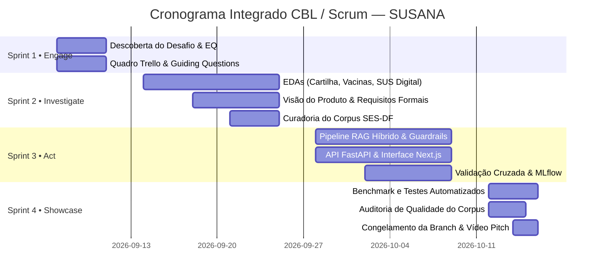

# Organização Ágil, Scrum e Rastreabilidade CBL — SUSANA

> **Projeto:** Meu SUS Brasília (SUSANA)  
> **Programa:** Residência em Inteligência Artificial — Instituto Eldorado  
> **Metodologia:** Challenge-Based Learning (CBL) integrado a Scrum / Kanban Ágil  
> **Status:** Documentação Homologada da Operação da Equipe  

---

## 1. Visão Geral da Gestão do Projeto

A execução do projeto **SUSANA** adotou uma abordagem híbrida, combinando os ciclos pedagógicos do **Challenge-Based Learning (CBL)** (*Engage, Investigate, Act*) com cerimônias e artefatos do **Scrum** e fluxo contínuo do **Kanban**. Essa estrutura garantiu cadência semanal, transparência de papéis, priorização orientada a valor para o cidadão do DF e mitigação antecipada de riscos técnicos e clínicos.

---

## 2. Composição da Equipe Multidisciplinar

A equipe foi dimensionada para cobrir ponta a ponta o ciclo de desenvolvimento de software, ciência de dados, engenharia de machine learning e validação de domínio em saúde pública:

| Membro | Papel Scrum Principal | Áreas de Atuação e Responsabilidades |
| :--- | :--- | :--- |
| **André Alves Acioli** | **Engenheiro de IA & MLOps** | Arquitetura RAG (ChromaDB + filtro por RA e regras lexicais), pipeline de embeddings, inferência local Ollama (Llama 3.1 8B), tracking e model registry no MLflow, guardrails clínicos. |
| **Samuel de Souza Rodrigues** | **Engenheiro de Software (Fullstack)** | Desenvolvimento da API FastAPI assíncrona, streaming de tokens via NDJSON, interface Next.js 16 (App Router / Tailwind), gerenciador de sessões e componentes visuais. |
| **Ingrid Hanna Nóbrega** | **Product Owner & Validação Clínica** | Curadoria das fontes oficiais da SES-DF e Ministério da Saúde, elaboração de requisitos e personas, condução de entrevistas de campo e garantia de conformidade ética e LGPD. |
| **Guilherme Barros Jr.** | **Cientista de Dados & Scrum Master** | Facilitação dos rituais ágeis, gestão do quadro Kanban no Trello, análises exploratórias de dados (EDAs de vacinação e cartilha), cálculo de correlações e benchmarks. |

---

## 3. Matriz de Responsabilidades (RACI)

* **R (Responsible):** Quem executa a atividade.  
* **A (Accountable):** Quem responde pela entrega e aprovação final.  
* **C (Consulted):** Quem é consultado ou fornece insumos.  
* **I (Informed):** Quem é mantido informado sobre o progresso.  

| Frente de Trabalho / Entregável | André | Samuel | Ingrid | Guilherme |
| :--- | :---: | :---: | :---: | :---: |
| Curadoria e Saneamento do Corpus Oficial | C | I | **A** | **R** |
| Análises Exploratórias de Dados (EDAs) | C | I | C | **A/R** |
| Engenharia de NLU e Toponímia do DF | **A/R** | **R** | C | I |
| Pipeline RAG (ChromaDB + regras lexicais) | **A/R** | C | I | I |
| Treinamento e Promoção de Guardrails (MLflow) | **A/R** | I | C | C |
| API FastAPI, Streaming e Persistência SQLite | C | **A/R** | I | I |
| Frontend Next.js 16 e Acessibilidade | I | **A/R** | C | I |
| Validação de Segurança Clínica e Aterramento nas Fontes | **R** | **R** | **A** | **R** |
| Bateria de Testes Automatizados (suíte do backend e 18 cenários) | **A/R** | **R** | C | **R** |
| Documentação e Portfólio de Entrega Final | **R** | **R** | **A** | **R** |

---

## 4. Dinâmica das Sprints no Roadmap CBL (6 Semanas)

O cronograma do Challenge 1 foi estruturado em quatro sprints alinhadas às fases pedagógicas:

### Sprint 1: Engage (Semana 1 • 07/09 a 11/09)
* **Objetivo:** Compreender a *Big Idea* (Fake News / Desinformação) e formular a *Essential Question*.
* **Principais Entregas:**
  - Quadro Trello do Challenge 1 configurado com as 20 Guiding Questions iniciais.
  - Priorização ágil nas raias: `RESPONDER JÁ`, `PLANEJAR`, `SE SOBRAR TEMPO`, `CORTAR SEM DÓ`.
  - Decisão arquitetural precoce: focar exclusivamente na saúde pública do DF e descartar fine-tuning oneroso de LLMs.

### Sprint 2: Investigate (Semanas 2–3 • 14/09 a 25/09)
* **Objetivo:** Investigar dados, fontes oficiais e necessidades reais dos cidadãos do SUS-DF.
* **Principais Entregas:**
  - 3 Notebooks de EDA: Carta de Serviços da SES-DF, séries temporais de vacinação na APS e bases do Meu SUS Digital.
  - Documento de [Visão do Produto](../produto/visao_do_produto.md) com 4 personas (Camila, Seu Raimundo, Felipe e usuário clínico).
  - Especificação formal de requisitos: 15 Requisitos Funcionais (RF) e 12 Requisitos Não Funcionais (RNF).
  - Coleta inicial e catalogação de bases abertas (InfoSaúde-DF, DATASUS, CNES).

### Sprint 3: Act (Semanas 4–5 • 28/09 a 09/10)
* **Objetivo:** Desenvolver o protótipo funcional integrado com IA local e salvaguardas clínicas.
* **Principais Entregas:**
  - Pipeline de RAG: vetorização densa com `paraphrase-multilingual-MiniLM-L12-v2` no ChromaDB, filtro por Região Administrativa, casamento lexical de termos/entidades e reordenação por regras.
  - Guardrail de segurança clínica com 5-Fold Stratified Cross-Validation registrado no MLflow (`@champion`) e regex de interceptação emergencial em $< 10\text{ ms}$.
  - Backend assíncrono em FastAPI com endpoint `/api/chat/stream` em NDJSON.
  - Frontend Next.js 16 com Mascote 3D, design tokens acessíveis e visualização de evidências oficiais.
  - Aterramento no corpus oficial e resposta padrão de ausência de informação quando não há evidência relevante.

### Sprint 4: Showcase & Refinamento (Semana 6 • 12/10 a 16/10)
* **Objetivo:** Validação experimental, auditoria de qualidade, congelamento do portfólio e preparação para apresentação.
* **Principais Entregas:**
  - Suíte de **151 testes** do backend passando integralmente (`pytest tests/`), incluindo cadastro/sessões, agenda, vacinas e isolamento entre usuários.
  - Bateria de 18 cenários ponta a ponta executada na homologação (18/18 aprovados; o script não está versionado, ver relatório técnico).
  - Cadastro opcional com login persistente, agenda com lembretes criados pelo chat (com confirmação), vacinas pendentes por perfil e monitoramento epidemiológico.
  - Pacote de implantação (Docker Compose, Caddy, guia Oracle Cloud); validação em produção em andamento.
  - Auditoria profunda do corpus (identificação e documentação de 2.283 blocos reais, limitações de links e saneamento).
  - Estruturação limpa da branch `entrega-final` no GitHub.

---

## 5. Rituais e Práticas da Equipe

1. **Daily Standups Assíncronas & Síncronas:** Alinhamento diário rápido de 15 minutos cobrindo: *o que foi feito ontem, o que será feito hoje e impedimentos identificados*.
2. **Sprint Planning:** Definição da meta da sprint, quebra de tarefas técnicas e estimativa de esforço relativo.
3. **Sprint Review:** Demonstração funcional do assistente respondendo a casos de teste com medição de latência e conferência de fontes.
4. **Retrospectiva Contínua:** Ajustes imediatos de rumo (ex.: inclusão do casamento lexical de termos e entidades quando a busca densa falhou em nomes exatos de medicamentos e em unidades numeradas).

---

## 6. Critérios de Qualidade e Prontidão

### Definition of Ready (DoR) — Quando uma tarefa pode entrar na Sprint:
* [x] A necessidade do cidadão ou do sistema está claramente descrita em formato de história de usuário ou requisito técnico.
* [x] A fonte oficial de dados (SES-DF ou MS) está identificada, acessível e validada.
* [x] Os critérios de aceite e os limites de segurança clínica estão formalizados.
* [x] As dependências com outros módulos (ex.: schema de dados ou portas da API) foram mapeadas.

### Definition of Done (DoD) — Quando um entregável é considerado concluído:
* [x] O código atende estritamente às diretrizes de privacidade (zero envio de PII para nuvens terceiras).
* [x] A funcionalidade foi submetida a testes automatizados (unitários e de regressão).
* [x] Em consultas que envolvem fatos, toda resposta inclui a citação da fonte oficial resolvida.
* [x] Em consultas de risco clínico, o sistema comprova bloqueio determinístico em $< 10\text{ ms}$.
* [x] A documentação técnica correspondente foi atualizada e versionada no repositório.
