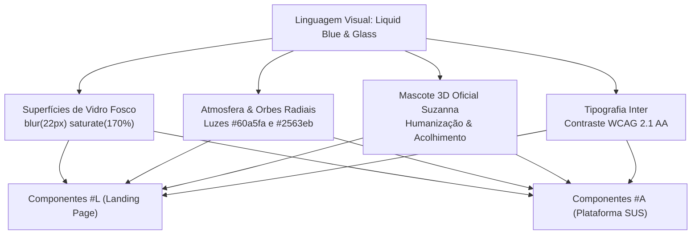
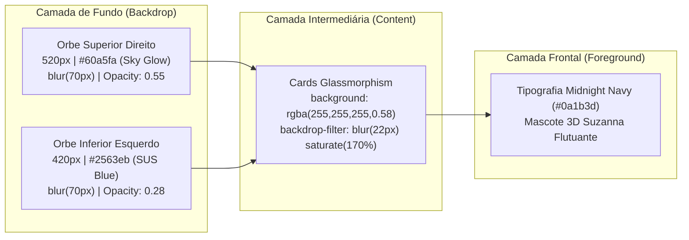
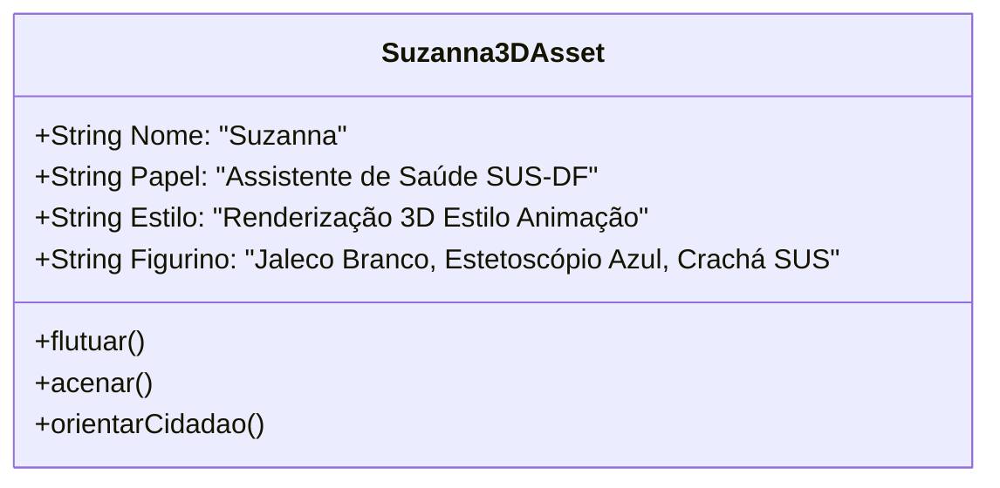
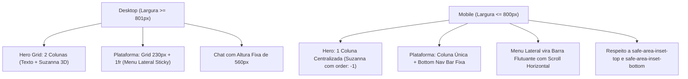

# 🎨 Sistema de Design e Identidade Visual Oficial — SUS Digital
## *Liquid Blue & Glassmorphism Design System — Projeto Suzanna*

---

## 📋 Sumário Executivo

Este documento estabelece a especificação canônica e completa da **Identidade Visual e Sistema de Design (Design System)** da plataforma **SUS Digital (Projeto Suzanna)**, desenvolvida para o ecossistema de saúde pública do Distrito Federal (SES-DF / Ministério da Saúde).

A linguagem visual é baseada no conceito **"Saúde pública, clara como água"**, combinando estética de vidro líquido (*liquid glassmorphism*), iluminação atmosférica suave por orbes radiais, acabamento pixel-perfect, tipografia neutra e de altíssima legibilidade, e a mascote 3D oficial **Suzanna** (renderizada em estilo de animação 3D amigável).



---

## 1. 💎 Manifesto Visual e Princípios Fundamentais

1. **Clara como Água (Transparência Óptica):** A saúde pública deve inspirar confiança imediata. O uso de camadas vítreas translúcidas com desfoque de fundo e bordas reflexivas cria profundidade hierárquica sem sobrecarregar o usuário.
2. **Acolhimento Humano (Suzanna 3D):** A mascote Suzanna humaniza o atendimento digital. Com jaleco branco, estetoscópio e crachá do SUS, ela equilibra profissionalismo clínico e simpatia acolhedora.
3. **Confiabilidade Clínica e Governança:** Todas as decisões visuais refletem o rigor do Sistema Único de Saúde. Ícones, rótulos e status seguem convenções clínicas reconhecíveis.
4. **Acessibilidade Universal (WCAG 2.1 AA):** Tipografia `Inter` de alta nitidez, suporte nativo a `prefers-reduced-motion`, áreas de toque ampliadas para idosos e suporte a safe areas móveis.

---

## 2. 🎨 Tokens de Design Canônicos (Design Tokens)

Os tokens visuais estão formalizados no arquivo `susana-ui/src/app/globals.css` sob escopos isolados: `#L` (Landing Page) e `#A` (Área da Plataforma).

### 2.1. Paleta de Cores e Tokens CSS

| Token CSS | Valor Hex / RGBA | Nome Comercial | Função Semântica / Aplicação |
| :--- | :--- | :--- | :--- |
| `--bg` | `#f5f9ff` | *Ice Serene Blue* | Fundo principal da página; tom relaxante de baixa fadiga ocular. |
| `--ink` | `#0a1b3d` | *Midnight Navy* | Cor do texto principal, títulos e elementos de máximo contraste. |
| `--mut` | `#5b6b8c` | *Steel Blue Mist* | Texto secundário, legendas, metadados e badges neutros. |
| `--b1` | `#1e40af` | *Deep Royal Blue* | Azul profundo; base de gradientes, sombras escuras e contornos. |
| `--b2` | `#2563eb` | *Electric SUS Blue* | **Azul Primário SUS Digital**; CTAs, botões ativos, balões do usuário e pins. |
| `--b3` | `#60a5fa` | *Sky Glow Blue* | Azul celeste de iluminação; orbes de topo, gradientes e destaques. |
| `--b4` | `#dbeafe` | *Soft Baby Blue* | Fundo de seleções, chips inativos, tags e contrastes suaves. |
| `--ok` | `#16a34a` | *Clinical Green* | Indicador de vacina aplicada, horários confirmados e status ok. |
| `--gl` | `rgba(255, 255, 255, 0.55)` | *Liquid Glass Base* | Fundo de superfícies translúcidas com alta transmitância de luz. |
| `--gl2`| `rgba(255, 255, 255, 0.28)` | *Subtle Glass* | Fundo de cards secundários e divisórias suaves. |
| `--ln` | `rgba(255, 255, 255, 0.75)` | *Specular Reflection* | Borda de 1px com reflexo especular de borda vítrea chanfrada. |
| `--fx` | `blur(22px) saturate(170%)` | *Liquid Optics Formula* | Filtro de desfoque óptico gaussiano com saturação de cores subjacentes. |

```css
/* Definição de Tokens em globals.css */
:root {
  --bg: #f5f9ff;
  --ink: #0a1b3d;
  --mut: #5b6b8c;
  --b1: #1e40af;
  --b2: #2563eb;
  --b3: #60a5fa;
  --b4: #dbeafe;
  --ok: #16a34a;
  --gl: rgba(255, 255, 255, 0.55);
  --gl2: rgba(255, 255, 255, 0.28);
  --ln: rgba(255, 255, 255, 0.75);
  --fx: blur(22px) saturate(170%);
}
```

---

## 3. 🔮 Atmosfera Óptica e Iluminação de Fundo

O design system constrói profundidade tridimensional utilizando **orbes radiais desfocados** fixados nas extremidades da tela, combinados com as camadas de vidro:



### 3.1. Especificação Técnica dos Orbes

1. **Orbe Superior Direito (`#A:before`):**
   - Dimensões: `520px x 520px`
   - Posição: `position: fixed; right: -120px; top: -100px; z-index: -1`
   - Cor: `var(--b3)` (`#60a5fa`)
   - Opacidade: `0.55`
   - Desfoque: `filter: blur(70px)`
2. **Orbe Inferior Esquerdo (`#A:after`):**
   - Dimensões: `420px x 420px`
   - Posição: `position: fixed; left: -120px; bottom: -120px; z-index: -1`
   - Cor: `var(--b2)` (`#2563eb`)
   - Opacidade: `0.28`
   - Desfoque: `filter: blur(70px)`
3. **Orbe Central do Hero (`#L .hero:before`):**
   - Dimensões: `70vw` (máx. `820px`), circular (`aspect-ratio: 1; border-radius: 50%`)
   - Posição: Atrás da mascote Suzanna
   - Gradiente: `radial-gradient(circle at 35% 30%, var(--b3), var(--b2) 45%, var(--b1))`
   - Desfoque: `filter: blur(2px)`

---

## 4. 🪞 Fórmula de Superfície Vítrea (Liquid Glassmorphism)

Todas as superfícies interativas que utilizam a classe `.glass` ou `.g` seguem a especificação física calculada para simular vidro polido com refração:

```css
/* Classe Canônica de Vidro (.glass / .g) */
.glass, .g {
  background: rgba(255, 255, 255, 0.58);
  backdrop-filter: blur(22px) saturate(170%);
  -webkit-backdrop-filter: blur(22px) saturate(170%);
  border: 1px solid rgba(255, 255, 255, 0.75);
  box-shadow: 
    0 8px 30px rgba(30, 64, 175, 0.10),
    inset 0 1px 0 rgba(255, 255, 255, 0.90),
    inset 0 -1px 0 rgba(255, 255, 255, 0.25);
}
```

### 4.1. Anatomia da Camada de Vidro
- **Transparência:** `58%` de base branca permite leitura confortável do conteúdo sem ofuscar o fundo dinâmico.
- **Backdrop-Filter:** `blur(22px)` difunde imagens de fundo enquanto `saturate(170%)` intensifica os tons de azul subjacentes, gerando um brilho vibrante característico.
- **Borda de Reflexo Especular:** `1px solid rgba(255, 255, 255, 0.75)` demarca o card e simula luz incidindo sobre o chanfro do vidro.
- **Sombra Dupla (Inset + Drop):** `inset 0 1px 0` cria um reflexo brilhante no topo superior interno; `box-shadow` externo difunde sombra azulada suave (`rgba(30, 64, 175, 0.10)`), eliminando o aspecto artificial de sombras pretas puras.

---

## 5. 👩‍⚕️ Mascote Oficial 3D: Suzanna

A mascote Suzanna é o elemento central de identidade visual da plataforma, servindo como guia amigável e autoridade em saúde pública digital.



### 5.1. Catálogo Oficial de Ativos Gráficos

Os arquivos oficiais estão catalogados e persistidos no repositório em `susana-ui/public/images/`:

| Arquivo de Imagem | Formato / Tamanho | Resolução / Uso Principal | Descrição Estética |
| :--- | :--- | :--- | :--- |
| **`suzanna-hero.webp`** | WebP · 29.4 KB | Hero da Landing Page (`#L .stage img`) | Renderização 3D de corpo inteiro/meio-corpo acenando amigavelmente, com jaleco branco, estetoscópio azul e fundo recortado (transparente). |
| **`suzanna-avatar.webp`** | WebP · 5.0 KB | Avatar do Chat e Menu Lateral (`aside .lg img`, `.m img`) | Close-up circular da mascote com sorriso acolhedor, otimizado para alta nitidez em tamanhos de 30px a 46px. |
| **`suzanna-lobby.jpg`** | JPEG · 51.8 KB | Banners institucionais e Modais de Onboarding | Renderização 3D cinematográfica no saguão de uma unidade moderna do SUS, com iluminação natural suave. |
| **`suzanna-poses.jpg`** | JPEG · 58.3 KB | Guia de Expressões & Design Manual | Prancha com múltiplos estudos de poses da mascote (escuta, explicação, verificação e acolhimento). |
| **`suzanna-sprites.png`** | PNG · 337.2 KB | Spritesheet de micro-animações | Sequência de quadros de animação para transições e estados interativos de interface. |

### 5.2. Micro-Animações da Mascote no Hero

A mascote no palco principal flutua com física orgânica suave e projeta sombra dinâmica:

```css
/* Animação de Flutuação da Mascote */
#L .stage img {
  position: relative;
  height: min(500px, 62vw);
  animation: fl 5s ease-in-out infinite;
  filter: drop-shadow(0 28px 30px rgba(10, 27, 61, 0.30));
}

@keyframes fl {
  0%, 100% {
    transform: translateY(0);
  }
  50% {
    transform: translateY(-12px);
  }
}
```

### 5.3. Tags de Vidro Flutuantes no Hero

Duas etiquetas informativas de vidro flutuam em torno da Suzanna no palco:
- `.t1` (topo esquerdo): *"Vacinação em andamento · Asa Norte"* (com micro-texto descritivo)
- `.t2` (inferior direito): *"Próxima consulta · Clínico geral · 14h"* (com atraso de fase de 3 segundos para contra-balanço dinâmico: `animation-delay: -3s`)

---

## 6. ✍️ Tipografia e Escala Hierárquica

A tipografia do sistema utiliza a família **Inter** (`var(--font-inter)`), configurada para altíssima legibilidade clínica tanto em telas Retina quanto em dispositivos de baixa resolução.

### 6.1. Escala Tipográfica

| Nível / Seletor | Tamanho da Fonte | Peso (Weight) | Altura de Linha (Line-Height) | Tracking (Letter-Spacing) | Uso |
| :--- | :--- | :--- | :--- | :--- | :--- |
| **Display H1** (`#L h1`) | `clamp(36px, 5.6vw, 66px)` | 300 (Light) | `1.04` | `-0.035em` | Título de impacto do Hero da Landing Page |
| **H1 Ênfase** (`#L h1 em`) | *Idem ao H1* | 600 (Semi-bold) | `1.04` | `-0.035em` | Palavra em destaque na cor `--b2` (*clara*) |
| **Platform H1** (`#A h1`) | `34px` | 300 (Light) | `1.2` | `-0.03em` | Saudação inicial da Plataforma (*Olá, Maria*) |
| **Eyebrow** (`#L .eyebrow`) | `13px` | 500 (Medium) | `1.2` | `+0.14em` | Rótulo superior em caixa alta e azul `--b2` |
| **Section H2** (`#L #chat h2`) | `clamp(28px, 4vw, 42px)` | 300 (Light) | `1.15` | `-0.03em` | Títulos de grandes seções de conversão |
| **Card H3** (`#A h3`, `#L .f h3`) | `16px a 20px` | 500 (Medium) | `1.3` | `-0.01em` | Títulos de cards de recursos e módulos |
| **Body Regular** (`p`, `.b`) | `15px a 17px` | 300 a 400 | `1.55 a 1.6` | Normal | Parágrafos, balões de conversa e descrições |
| **Labels / Badges** (`.pill`, `.tag`) | `11px a 13px` | 500 (Medium) | `1.2` | Normal | Indicadores de status, RAs e tipos de unidade |
| **Meta / Data** (`small`, `.mut`) | `11px a 12px` | 300 a 400 | `1.3` | Normal | Horários, fontes de dados e notas de rodapé |

---

## 7. 🧩 Componentes do Sistema de Design

### 7.1. Botões e Ações (Buttons & CTAs)

O design adota formato pílula total (`border-radius: 99px`) com gradiente vertical iluminado:

```css
/* Botão Primário de Ação */
.btn {
  display: inline-block;
  background: linear-gradient(180deg, var(--b3), var(--b2) 60%, var(--b1));
  color: #ffffff !important;
  border: 0;
  border-radius: 99px;
  padding: 12px 26px;
  font: 500 15px var(--font-inter), 'Inter', sans-serif;
  cursor: pointer;
  text-decoration: none;
  box-shadow: 0 8px 20px rgba(37, 99, 235, 0.35), inset 0 1px 0 rgba(255, 255, 255, 0.50);
  transition: transform 0.25s ease, box-shadow 0.25s ease;
}

.btn:hover {
  transform: translateY(-2px);
  box-shadow: 0 14px 28px rgba(37, 99, 235, 0.40), inset 0 1px 0 rgba(255, 255, 255, 0.50);
}
```

### 7.2. Barra de Navegação Flutuante da Landing Page (`nav.glass`)
- **Posição:** Fixada centralizada no topo (`left: 50%; transform: translateX(-50%); top: 14px; z-index: 10`).
- **Dimensões:** `width: min(92%, 720px); border-radius: 99px; padding: 8px 8px 8px 20px`.
- **Conteúdo:** Logotipo tipográfico `SUS Digital` com a palavra `Digital` em `--b2`, e botão pílula `Falar com a Suzanna`.

### 7.3. Menu Lateral da Plataforma (`aside.g`)
- **Desktop:** Coluna sticky de `230px`, altura total calculada (`calc(100vh - 40px)`), cantos arredondados de `28px`.
- **Cabeçalho:** Avatar circular oficial da Suzanna (`36px x 36px`) com tipografia `SUS Digital`.
- **Botões de Navegação:**
  - Inativo: Cor muted `--mut`, hover com fundo branco translúcido.
  - Ativo (`.on`): Fundo sólido `--b2` (`#2563eb`), texto branco, sombra azul `0 6px 16px rgba(37, 99, 235, 0.35)`.
- **Versão Mobile (<800px):** Transforma-se automaticamente em **Bottom Navigation Bar** fixa com pílula flutuante na base da tela (`bottom: 10px`), com scroll horizontal e `border-radius: 99px`.

### 7.4. Módulo de Chat Conversacional (`.chat.g`)
- **Container:** Caixa de vidro de `560px` de altura com cantos de `28px`.
- **Balões de Mensagem (`.m`):**
  - **Mensagem da Suzanna (`.m.bot`):** Alinhada à esquerda com avatar oficial circular (30px), balão branco leitoso translúcido (`rgba(255, 255, 255, 0.90)`), canto inferior esquerdo afunilado (`border-bottom-left-radius: 6px`).
  - **Mensagem do Usuário (`.m.me`):** Alinhada à direita, fundo azul elétrico `--b2` (`#2563eb`), texto branco, canto inferior direito afunilado (`border-bottom-right-radius: 6px`).
- **Indicador de Digitação (`.dots`):** 3 pontos azuis com animação escalonada por keyframes (`@keyframes d`).
- **Chips de Sugestão Rápida (`.chips`):** Pílulas brancas horizontais com texto `--b1`, bordas suaves e transição para `--b2` no hover.
- **Campo de Entrada (`.in`):** Barra com input cilíndrico de alta nitidez e botão de envio em gradiente circular.

### 7.5. Mapa Interativo de Unidades de Saúde do DF (`.map.g`)
- **Fundo Cartográfico:** Gradiente suave vetorial (`linear-gradient(135deg, #eaf2ff, #cfe1fd)`).
- **Vias Expressas:** Traçados SVG curvos estilizados simulando os eixos rodoviários do DF (Eixo Monumental, Eixão, EPTG, Estrutural).
- **Pinos de Unidade (`.pin`):** Círculos em azul `--b2` com anel pulsante e transição suave no hover (`r: 11`).
- **Card Deslizante de Detalhes (`.det.g`):** Painel de vidro fixado na base do mapa com animação vertical fluida (`transform: translateY(130%) -> none`) que exibe nome da unidade, endereço, horário e serviços.

### 7.6. Calendário Oficial do SUS (`.cal`)
- **Grade:** Grid de 7 colunas (Domingo a Sábado).
- **Estados dos Dias:**
  - Inativo / Bloqueado: Texto suave `#b4bfd6`.
  - Disponível (`.a`): Fundo azul celeste translúcido (`rgba(96, 165, 250, 0.16)`), cursor pointer, hover para `--b3`.
  - Selecionado (`.s`): Azul sólido `--b2` (`#2563eb`) com texto branco e sombra de destaque.

### 7.7. Gráfico Epidemiológico de Dengue (Spline & Barras)
- **Spline Contínuo (`#ln`):** Curva de casos por semana epidemiológica (S36 a S45) traçada com interpolação cúbica Bézier em SVG, combinada com gradiente linear preenchido abaixo da curva.
- **Barras por Região Administrativa (`.bar i`):** Barras horizontais arredondadas em gradiente `--b3` -> `--b2` com animação de expansão suave via CSS transition.

### 7.8. Acordeões de Histórico Clínico (`.ac.g`)
- **Transição Pura em CSS Grid:** Abertura sem JavaScript calculando alturas manuais (`grid-template-rows: 0fr -> 1fr` com transição de 0.4s).
- **Ícone Expandir:** Símbolo `+` em azul `--b2` que rotaciona suavemente 45° virando um `×` de fechamento.

---

## 8. 📱 Responsividade e Adaptação Multi-Dispositivo

O layout é completamente responsivo e possui adaptações específicas para telas compactas:



### 8.1. Regras do Breakpoint `max-width: 800px`

```css
@media (max-width: 800px) {
  /* Adaptação da Landing Page */
  #L .hero {
    grid-template-columns: 1fr;
    text-align: center;
    padding-top: 100px;
  }
  #L .stage {
    order: -1;
    min-height: 380px;
  }
  
  /* Adaptação da Plataforma */
  #A .app {
    grid-template-columns: 1fr;
    padding: 12px 12px 90px;
  }
  #A aside {
    position: fixed;
    z-index: 9;
    top: auto;
    bottom: calc(10px + env(safe-area-inset-bottom, 0px));
    left: 10px;
    right: 10px;
    height: auto;
    flex-direction: row;
    padding: 6px;
    border-radius: 99px;
    overflow-x: auto;
  }
  #A aside .lg {
    display: none;
  }
}
```

---

## 9. ♿ Acessibilidade e Movimento Reduzido (a11y)

Para respeitar as diretrizes de acessibilidade e evitar desconforto visual em usuários com distúrbios vestibulares, todo o sistema possui desativação global de animações:

```css
@media (prefers-reduced-motion: reduce) {
  #L *, #A * {
    animation: none !important;
    transition: none !important;
  }
}
```

- **Contraste de Texto:** O texto principal `#0a1b3d` contra fundos de vidro e o fundo sereno `#f5f9ff` oferece contraste superior a **12:1**, excedendo amplamente a exigência mínima de 4.5:1 da WCAG AA.
- **Foco Acessível:** Todos os campos de input utilizam anel de foco destacado com 2px em `--b3` (`outline: 2px solid var(--b3)`).
- **Áreas de Toque:** Todos os botões, chips e abas possuem altura mínima de clique de **44px** recomendada para dispositivos táteis.

---

## 10. 🛡️ Regras Invioláveis de Governança Visual do Squad

1. **Escopo Obrigatório `#L` e `#A`:** Nenhum estilo deve vazar globalmente. A Landing Page pertence ao seletor `#L` e a Plataforma pertence ao seletor `#A`.
2. **Proibição de "AI Template Look":** É estritamente vedado o uso de bibliotecas genéricas sem personalização (como cards brancos opacos sem identidade, sombras puramente pretas ou fontes sem serifa padrão de sistema sem ajustes de tracking e leading).
3. **Preservação dos Ativos da Suzanna:** Os nomes e resoluções dos ativos WebP em `susana-ui/public/images/` devem ser mantidos como fonte única da verdade para a renderização da mascote.
4. **Desacoplamento e Pureza de Layout:** Componentes de calendário, mapa e gráficos devem manter o padrão de vidro com borda `--ln` e sombras azuis calculadas.
5. **Zero Modificações de Git sem Autorização:** Todas as alterações devem ser auditadas e preservadas sem commits diretos para o repositório remoto.

---

*Documento homologado pela Equipe de Design & Arquitetura do SUS Digital (Projeto Suzanna).*
